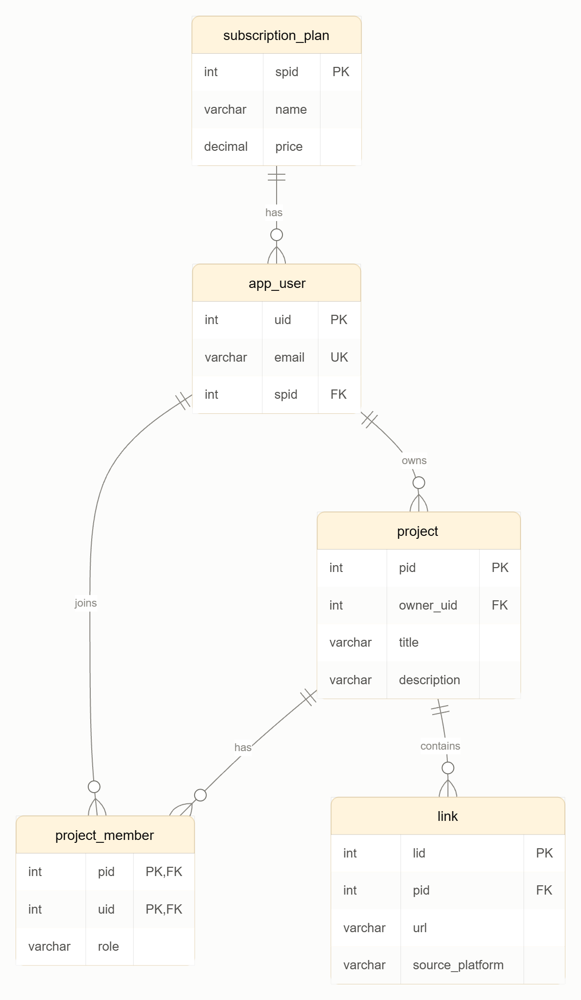

# Syncore

> **One workspace. Every resource. Zero setup friction.**


---

## Overview

Syncore is a centralized project management hub that gathers a team's scattered external resources (documents, repositories, and design files) into a single, accessible dashboard, with no accounts, passwords, or onboarding barriers.

**The problem:** Project work lives across many tools, and keeping everyone aligned means chasing links through chats and emails. Most project hubs add their own friction on top: sign-ups, verification steps, and heavy file uploads.

**The solution:** A team creates a workspace in seconds and shares an **access code**. Collaborators enter the code, type their **name**, and they're in. Syncore doesn't host files. It acts as a lightweight, real-time **link directory and task tracker**, so every contributor stays synced.

## Key Features

- **Instant workspaces**: generate a project workspace with a single action
- **Access-code invitations**: invite collaborators by sharing a simple code, with no authentication flow
- **Name-only onboarding**: new members are asked for just their name on entry
- **Centralized resource dashboard**: organize links to documents, repositories, and design files in one view
- **Task tracking**: keep team responsibilities visible alongside the resources they relate to
- **Real-time sync**: updates are reflected for all members so the team stays aligned
- **Lightweight by design**: a link directory rather than a file-hosting service, keeping the platform fast and simple

## Data Model

Syncore is designed database-first. The entity-relationship diagram below shows the core entities and how they relate.



## Tech Stack

| Layer | Technology |
|---|---|
| UI | Blazor, Tailwind CSS |
| Language / Framework | C#, .NET (Blazor) |
| Database | PostgreSQL |
| Tools | Git |

## Getting Started

### Prerequisites

- [.NET SDK](https://dotnet.microsoft.com/download)
- [PostgreSQL](https://www.postgresql.org/download/)

### Installation

```bash
# Clone the repository
git clone https://github.com/<your-username>/syncore.git
cd syncore

# Configure your PostgreSQL connection string
# (e.g., in appsettings.Development.json)
```

### Running the Project

```bash
dotnet restore
dotnet run
```

## Project Structure

```
syncore/
├── Syncore_ERD.png      # Entity relationship diagram
├── README.md
└── ...                  # Folders will be added as the project grows
```

## Roadmap

- [x] Database design and ERD
- [ ] Workspace creation and access-code join flow
- [ ] Resource link directory
- [ ] Task tracker
- [ ] Real-time updates across members
- [ ] Responsive UI with Tailwind CSS
- [ ] Testing, documentation, and deployment

## Author

**[Your Name]**
[GitHub](https://github.com/<your-username>) · [LinkedIn](https://linkedin.com/in/<your-profile>) · [Email](mailto:you@example.com)

---

*Syncore is under active development. Feedback is welcome.*
